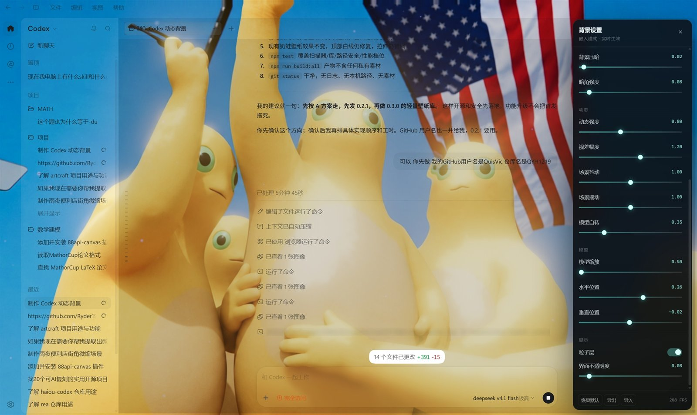
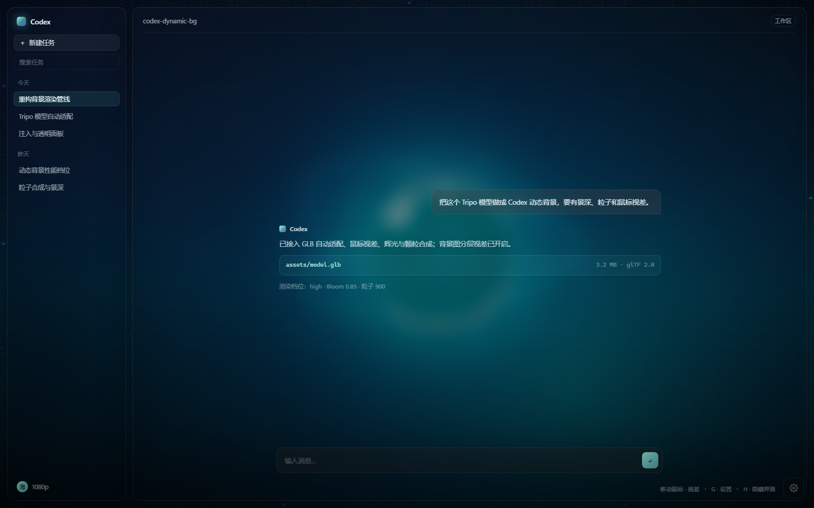

# Codex Dynamic Background

An interactive WebGL background layer for Codex Desktop: custom artwork, Tripo GLB models, mouse parallax, bloom, particles, model rotation, and translucent Codex panels.

[中文](README.md) | **English**





> The right screenshot is the built-in local mock shell (`?mock=1`), not a capture of Codex itself.

## Features

- Full-window background rendered behind the Codex UI, with `pointer-events: none`.
- Custom background image (WebP / PNG / JPG), video (MP4 / WebM), or Wallpaper Engine `scene` wallpaper sampled by a fullscreen shader with slow drift and parallax.
- Scene effect replay: automatic `scene.pkg` extraction, with shader ports for `shake` flow-map motion and `foliagesway` vegetation sway.
- GLB / glTF loading with automatic centering and bounding-box scaling; Draco, Meshopt, and KTX2 supported.
- Model spin, mouse tilt, bloom, particles, vignette, film grain, and click ripples.
- Live settings panel with persisted configuration.
- Translucent main surface and side panels; settings pages fall back to opaque.
- Runtime injection over the Chrome DevTools Protocol. No files inside the Codex installation are modified.
- Works without any assets: procedural background plus a placeholder crystal.
- No backend, no telemetry, no uploads.

## Requirements

| Item | Requirement |
| --- | --- |
| Node.js | >= 22 |
| Codex Desktop | Electron build (Windows primary; macOS/Linux scripts experimental) |
| Renderer | WebGL2-capable Chromium |
| OS | Windows 10/11 (primary); macOS/Linux can run the preview |

## Quick start

```bash
git clone https://github.com/<your-name>/codex-dynamic-bg.git
cd codex-dynamic-bg
npm install
npm run dev
```

Open <http://127.0.0.1:5273/>.

The first run copies the bundled Draco / Basis decoders from Three.js into `public/vendor/`. That directory is generated and ignored by Git.

### Preview modes

| URL | Result |
| --- | --- |
| `/` | Background + local mock Codex shell |
| `/?mock=0` | Background only |
| `/?mock=1` | Force the mock shell |
| `/?panel=1` | Open the settings panel on load |
| `/?embed=1` | Embedded mode (no HUD / panel / mock) |

Shortcuts: `G` toggles settings, `H` toggles the HUD, `Esc` closes the panel.

## Add your assets

One command installs and normalizes assets, and removes higher-priority leftovers so switching from a video to a still image actually takes effect:

```bash
npm run use -- "C:\Pictures\my-bg.png"              # png/jpg/webp/avif
npm run use -- "C:\Videos\loop.mp4"                 # mp4/webm (.mov needs ffmpeg)
npm run use -- "C:\Models\figure.glb"               # Tripo export
npm run use -- "D:\steam\steamapps\workshop\content\431960\3806385218"
                                                    # Wallpaper Engine project, auto-detected
npm run use -- --scene "C:\path\to\unpacked-scene"  # already-unpacked scene
npm run use -- --clear                              # clear background, keep the model
npm run use -- --dry-run                            # print the plan only
```

After installing: refresh the preview, or rebuild for injection with `npm run embed && npm run inject`.

You can also drop files into `public/assets/` manually using any of these names:

```text
public/assets/background.webp   # or .png / .jpg / .jpeg
public/assets/background.mp4    # or .webm, takes priority over the still image
public/assets/model.glb         # or .gltf with its .bin and textures
public/assets/wallpaper/scene.json  # generated by the wallpaper importer
```

Without assets the app still runs with the procedural background and placeholder model.

Fit rules: compute the bounding box, center it at the origin, scale the longest edge to `3.35` scene units, then add a thin wireframe shell. Original materials, textures, and animations are preserved.

See [docs/ASSETS.md](docs/ASSETS.md) for details.

## Import from Wallpaper Engine

| `project.json` type | Path |
| --- | --- |
| `video` | Imported directly as the animated background |
| `web` | Copied to `public/wallpaper/`, then needs a compatibility pass |
| `scene` | Unpacked with RePKG automatically; artwork and effect masks are normalized; `shake` and `foliagesway` are replayed in shader |
| `application` | Native app; rebuild from its preview video instead |

```bash
# Import the wallpaper currently selected in Wallpaper Engine
npm run wallpaper -- --current

# Import by workshop id or folder
npm run wallpaper -- 3806385218
npm run wallpaper -- "D:\SteamLibrary\steamapps\workshop\content\431960\123456789" --dry-run
npm run wallpaper -- "D:\...\123456789"
```

The importer writes `public/assets/background.mp4|webm` for video wallpapers and `public/assets/wallpaper/{scene.json,artwork,masks}` for scene wallpapers. It auto-detects Steam, Wallpaper Engine, and RePKG; use `--repkg PATH` to override the RePKG binary or `--scene DIR` for an already-unpacked scene. Unsupported effects are reported and skipped while the artwork still loads. See [docs/ASSETS.md](docs/ASSETS.md).

## Build

```bash
npm run build:all
```

| Output | Purpose |
| --- | --- |
| `dist/` | Standalone preview site |
| `dist-embed/codex-dynamic-bg.iife.js` | Single-file IIFE bundle for injection |

Or separately:

```bash
npm run build
npm run embed
```

## Inject into Codex Desktop

Injection uses the Chromium remote debugging port. A running Electron instance cannot open that port retroactively, so Codex must be restarted through the launcher.

### 1. Launch Codex with CDP

Windows:

```powershell
npm run launch:codex
```

If Codex is already running the launcher refuses to continue. To explicitly restart it:

```powershell
powershell -NoProfile -ExecutionPolicy Bypass -File tools/launch-codex.ps1 -KillExisting
```

Custom path or port:

```powershell
powershell -NoProfile -ExecutionPolicy Bypass -File tools/launch-codex.ps1 -AppPath "C:\Path\To\ChatGPT.exe" -Port 9222
```

macOS / Linux:

```bash
bash tools/launch-codex.sh
```

### 2. Verify CDP

```bash
npm run inject -- --list
```

### 3. Inject

```bash
npm run embed
npm run inject
```

What happens:

- connects to `http://127.0.0.1:9222`
- serves `public/assets/` locally (default port `5275`)
- registers the bundle through `Page.addScriptToEvaluateOnNewDocument`
- reloads the page and verifies `#cxd-bg-root`

### Injector CLI

```text
--port 9222          CDP port
--asset-port 5275    local asset server port
--assets PATH        directory mapped to /assets/ (default: public/assets)
--vendor PATH        directory mapped to /vendor/ (default: public/vendor)
--bundle PATH        IIFE bundle (default: dist-embed/codex-dynamic-bg.iife.js)
--target TEXT        match a page target by id / title / URL substring
--image URL          explicit background URL or /assets/... path
--model URL          explicit model URL or /assets/... path
--surface NUMBER     panel opacity, 0..1 (default 0.22; lower = clearer artwork)
--dim NUMBER         background dim, 0..1 (default 0.12)
--asset-base URL     override the asset base URL
--no-reload          inject without reloading
--no-serve           do not start the local asset server
--list               list CDP page targets and exit
-h, --help           help
```

### Remove the background

Restart Codex, or run `window.cxdBg.dispose()` in the DevTools console.

See [docs/INJECTION.md](docs/INJECTION.md) for the full flow and troubleshooting.

## Configuration

Stored in `localStorage` under `codex-dynamic-bg:v2`:

| Key | Default | Description |
| --- | --- | --- |
| `quality` | `high` | `low` / `medium` / `high` |
| `motion` | `1` | Global motion strength |
| `parallax` | `1` | Mouse parallax |
| `bloom` | `0.85` | Bloom strength |
| `grain` | `0.55` | Film grain |
| `dim` | `0.12` | Background dimming |
| `vignette` | `0.45` | Vignette strength |
| `modelScale` | `1` | Model scale |
| `modelSpin` | `0.35` | Model rotation speed |
| `modelX` / `modelY` | `0.18` / `-0.02` | Model screen offset |
| `sceneShake` | `1` | Scene wallpaper shake strength |
| `sceneSway` | `1` | Scene wallpaper foliage sway strength |
| `particles` | `true` | Particle toggle |
| `codexMock` | `true` | Mock shell in preview |
| `surfaceOpacity` | `0.22` | Codex panel opacity (live in injection mode) |
| `showPanel` | `false` | Settings panel state |

## JavaScript API

```js
cxdBg.setConfig({ bloom: 1.2, modelSpin: 0.6, quality: 'medium' });
cxdBg.reset();
console.log(cxdBg.assets);
cxdBg.dispose();
```

```js
window.addEventListener('cxdbg-ready', (event) => {
  console.log(event.detail);
});
```

## Project layout

```text
src/            renderer, scene modules, UI, config
tools/          CDP injector, decoder sync, launchers
public/assets/  your artwork and models (ignored by Git)
docs/           architecture, injection, asset docs
```

## Known limitations

- Codex DOM classes can change between releases. All selectors live in `CXD_CODEX_CSS` inside `src/embed.js`.
- Injection lives only for the current Codex process.
- Keep the CDP port bound to `127.0.0.1`.
- 4K artwork plus large models can be GPU-heavy; lower `quality` first.
- Washed-out artwork: inject with `--surface 0.15 --dim 0.05`. Lower panel opacity makes the background clearer at the cost of text contrast.
- Linux/macOS launcher paths and process names may need adjustment.

## Privacy

No telemetry. Assets are read locally and never uploaded. The injected script is delivered over CDP and does not modify the Codex installation.

## Contributing

See [CONTRIBUTING.md](CONTRIBUTING.md) and [SECURITY.md](SECURITY.md).

## License

[MIT](LICENSE)

Unofficial project. Not affiliated with OpenAI. Codex is a trademark of its respective owner.

