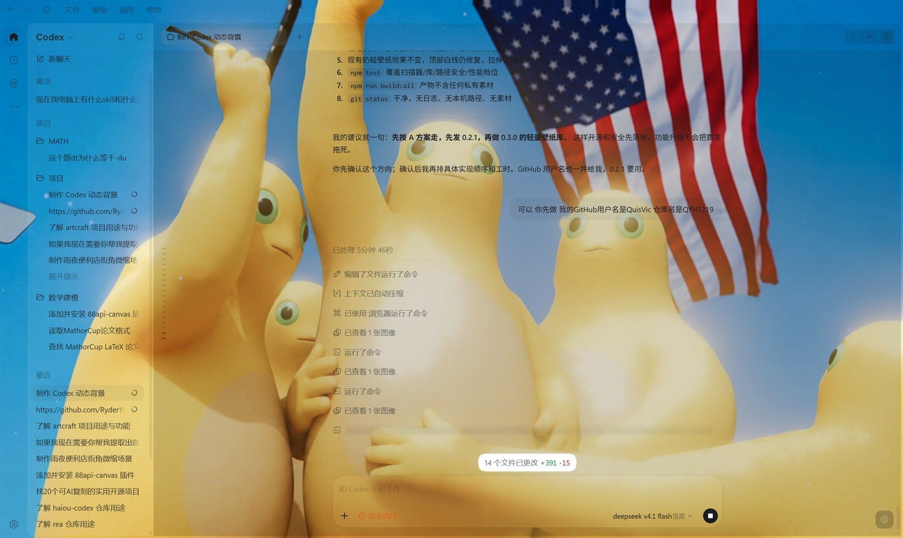
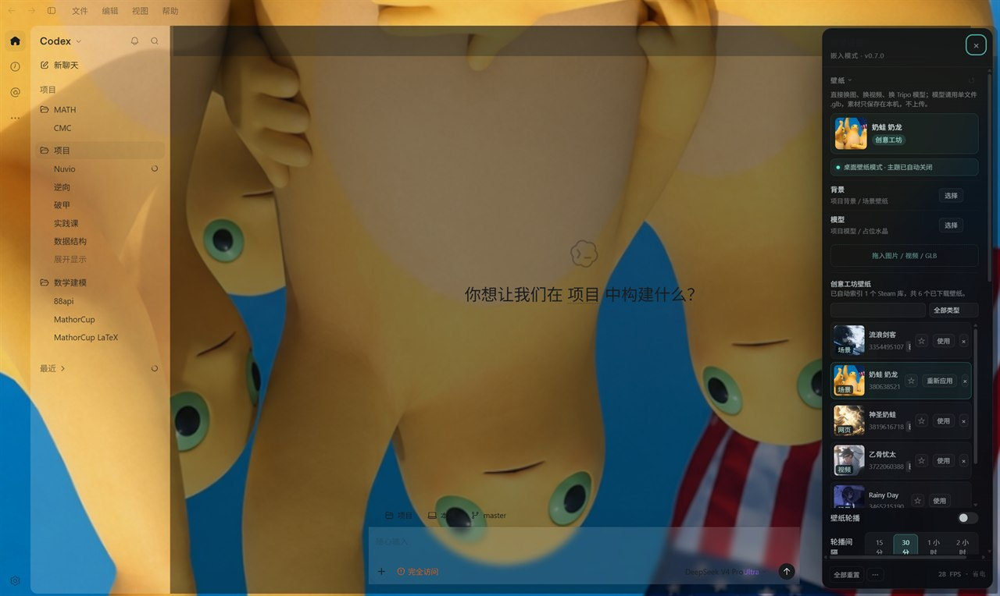

# Nuvio

An interactive WebGL background layer for Codex Desktop: custom artwork, Tripo GLB models, mouse parallax, bloom, particles, model rotation, and translucent Codex panels.

Nuvio is the project's new name (formerly Codex Dynamic Background). Only the public brand changed: local storage keys, the wallpaper library and the config format are unchanged, so upgrading keeps your saved scene.

[中文](README.md) | **English**




> Captured from the built-in demo surface (`npm run dev`): the backdrop is a procedurally generated abstract image and the UI is the bundled Codex mock panel. **No user artwork or chat content is included.**
> After injection the real Codex window behaves the same way: the backdrop fills the window, and the sidebar, chat area and composer are all translucent with the top fade overlay disabled.


> Real-environment demo: the NestWave wallpaper is stretched to cover the whole window without cropping. Original artwork by **小涂真纪-**; shown for interface demonstration only.



> The panel is down to four sections and 12 controls: the workshop indexes itself, quality tiers never change framing, and the panel and composer always let the artwork show through.

---

## Features

- **Full-window background layer**: rendered behind the Codex UI, with no pointer interception.
- **Image / video / scene / web wallpapers**: WebP / PNG / JPG, MP4 / WebM, an imported Wallpaper Engine `scene`, or a self-contained `web` project rendered in a sandboxed iframe.
- **Scene effect replay**: automatic `scene.pkg` extraction, replaying `shake`, `foliagesway`, `waterwaves`, `waterripple`, and `waterflow` in the same order Wallpaper Engine applies them.
- **Tripo / glTF models**: GLB and glTF loading with automatic centering and bounding-box scaling; Draco, Meshopt, and KTX2 supported.
- **Motion**: model spin, mouse tilt, vignette, film grain, and click ripples. Bloom and particles only run on the procedural fallback; once a wallpaper is active they stay off so the artwork keeps its detail.
- **12 controls, four sections**: wallpaper, look, performance, system. Theme, vignette, bloom, grain, particles, scene sway/water/shake, model placement and JSON import/export still exist in the config and are still honoured by the renderer; they are simply not sliders anymore.
- **Assets from the settings panel**: pick or drop images, videos, and single-file GLBs without touching a terminal. Files stay in local IndexedDB and survive reloads.
- **Creative workshop**: the injector indexes Wallpaper Engine wallpapers already downloaded locally (`431960`) on startup and watches every Steam library, so a new subscription appears on its own. No scan button, no network access and no automatic downloads.
- **Current wallpaper identity**: the top of the panel shows the live wallpaper's thumbnail, title, and source (local file / workshop / project asset / procedural), so multiple imports never become ambiguous.
- **Favorites and rotation**: star workshop cards (`☆` / `★`), filter with `★ 收藏`, and optionally rotate every N minutes. Rotation prefers favorites, otherwise uses imported wallpapers, starts disabled, and never replaces the current frame immediately.
- **Local wallpaper library**: imported video/scene wallpapers live under `public/assets/library/<id>/`; `active.json` records the applied wallpaper and restores it after reloads.
- **Two fill modes, no cropping**: `stretch` (default) fills the window without trimming the artwork; `contain` keeps the original aspect ratio with letterboxing. Legacy `auto` / `cover` values migrate to `stretch`.
- **Baked scene wallpapers**: scene art plays through a single-pass lite material (one artwork texture, at most two amplitude masks, sine displacement and parallax). A typical scene drops from five textures to three; scenes without a mask fall back to the full shader.
- **Automatic readability**: the wallpaper is sampled once on a 32×32 offscreen canvas (luminance, edge density, contrast) to choose background dim and panel frost, with hysteresis so sampling noise cannot rewrite the config.
- **Lightweight quality tiers**: Saver / Balanced / High, with Saver as the default. Tiers only change sampling density and the FPS cap, never the framing. Sustained low FPS drops one tier, static wallpapers can stop rendering while idle, and rendering pauses when the window loses focus. Software rasterizers and old integrated GPUs are automatically capped at 24 FPS without changing sampling or composition.
- **Desktop wallpaper mode**: picking an image, video, or scene wallpaper switches to the crisp desktop look and removes the extra blur/vignette overlay. Once artwork owns the screen, theme presets are no longer layered on top.
- **Settings in injected mode**: a compact panel is available from the bottom-right gear or `G`. Sections collapse and reset individually; JSON export/import lives in the `⋯` menu (config only, no wallpaper files).
- **Translucent Codex shell**: main surface and side panels become translucent; wallpaper mode also removes Codex workspace pseudo-surface overlays and blur, while settings pages stay opaque.
- **Persistent settings**: configuration is stored in `localStorage` and restored on the next injection.
- **Runtime injection**: delivered over the Chrome DevTools Protocol without modifying the Codex installation. A resident injector keeps the layer alive across reloads.
- **Diagnostics and restore**: the runtime panel shows FPS, GPU, frame cap, drawing buffer, texture memory, draw calls, missing scene textures, and skipped water stages. `npm run doctor` checks the build, assets, CDP, and resident injector; `npm run restore` removes the layer and optionally clears settings.
- **Manual update check**: the System section shows the current version and contacts GitHub Releases only after you click `检查更新`.
- **No assets required**: falls back to a procedural background and placeholder crystal.
- **No backend, no telemetry**: assets are read locally and never uploaded.

## Requirements

| Item | Requirement |
| --- | --- |
| Node.js | >= 22 |
| Codex Desktop | Electron build (Windows primary; macOS/Linux scripts experimental) |
| Renderer | WebGL2-capable Chromium |
| OS | Windows 10/11 (primary); macOS/Linux can run the preview |

## Quick start

```bash
git clone https://github.com/QYH1219/Nuvio.git
cd Nuvio
npm install
npm run dev
```

Open <http://127.0.0.1:5273/>.

The first run copies the bundled Draco / Basis decoders from Three.js into `public/vendor/`. That directory is generated and ignored by Git.

If the page, CDP, or assets behave unexpectedly, run `npm run doctor` first.

The repository ships **no wallpaper artwork**. Images, videos, scene wallpapers,
and GLB models under `public/assets/` are ignored by `.gitignore`; a fresh clone
starts with the procedural placeholder. Add your own with
`npm run use -- <file-or-directory>` or by dropping files into `public/assets/`.

### One-command start (Windows)

Double-click `start.cmd` in the repository root, or run:

```bash
npm start
```

The launcher installs missing dependencies, builds the injection bundle, checks CDP, starts Codex with the debugging port when needed, then injects and stays resident. The injector detaches into the background by default; use `--foreground` when you want live logs in the console.

- There is exactly one desktop shortcut. It starts Codex with the debugging port when needed, asks before restarting a running instance that has no port, then injects. The saved wallpaper and appearance survive the restart.
- `npm run shortcut` creates the single `Nuvio` shortcut; `npm run shortcut -- --remove` deletes it. The launcher window starts minimized; use the taskbar button to read the log.
- Keep the current window: `npm start -- --no-restart`. Accept the prompt non-interactively: `--yes`. Skip the prompt and restart: `--restart`. Replace an already resident injector: `npm start -- --force`.
- The injector runs hidden in the background and logs to `.nuvio/injector.log`; stop it with `npm run restore`, or use `npm start -- --foreground` for an attached console.
- CDP already handled elsewhere: `npm start -- --no-launch`. Force a rebuild: `npm start -- --build`.

#### Magpie coexistence

On Windows, shortcuts, `npm start`, and restart share one bounded, hidden
preflight. When Magpie is installed, it waits for the local gateway, applies
`88api/gpt-6.1-sol` / `ultra` through Magpie's CLI, and sets the desktop effort
list to `ultra / high / medium`. Configuration edits keep UTF-8 paths and other
tables intact and create `config.toml.nuvio-backup-*` before changes. Missing
Magpie is skipped; a failed preflight warns but does not prevent Nuvio starting.

The launch pin then verifies for 10 seconds (returning early once the file has
been stable for 3) and re-pins on drift. After that a bounded, hidden 30-second
watcher covers the window where Magpie's own autostart rewrites `config.toml`
again a few seconds after Codex opens; it retries at most 8 times and exits on
its own. This is deliberately not a permanent lock: changing settings in Magpie
later still wins. Set `NUVIO_SKIP_MAGPIE=1` before launch to keep your own model
selection. `--help` and `--no-launch` skip the preflight. Logs:
`%TEMP%\nuvio\magpie-ultra.log`. `--no-restart` keeps the current Codex window
even when `--yes` is also present.

An HTTP 200 response with `reasoning_tokens` confirms reasoning output; it does
not independently establish that a third-party provider honored the requested
effort level without substituting another level.

#### Wallpaper bundles, portable build, autostart

```powershell
npm run bundle -- export --name nestwave
npm run bundle -- import "exports/nestwave.nuvio.zip"
npm run pack
npm run autostart -- enable
npm run autostart -- status
npm run autostart -- disable
```

`npm run bundle` packages the active wallpaper, scene/mask files, library entries and panel config into one `.nuvio.zip`. `npm run pack` writes `dist/nuvio-<version>-portable.zip`; no `npm install` is required on the target machine. Autostart uses the current user's Startup folder and needs no administrator rights. Bundles live in `exports/`, runtime state in `.nuvio/`; neither is committed.

### Preview modes

| URL | Result |
| --- | --- |
| `/` | Background + local mock Codex shell |
| `/?mock=0` | Background only |
| `/?mock=1` | Force the mock shell |
| `/?panel=1` | Open the settings panel on load |
| `/?embed=1` | Embedded mode (no HUD / mock, keeps the gear and settings panel) |

Shortcuts: `G` toggles the settings panel, `H` toggles the HUD, `Esc` closes the panel.

#### Scene shader preview (development)

`shader-preview.html` renders a scene effect pipeline without mounting the full
settings UI. Export a private fixture into `public/__shader-preview__/` (that
directory is gitignored and stripped from release builds), then open:

```text
http://127.0.0.1:5273/shader-preview.html?t=0
http://127.0.0.1:5273/shader-preview.html?t=4
```

`t` freezes the animation time so two frames can be compared with a pixel
diff. Without a fixture the page shows setup instructions and leaves normal
preview/injection untouched.

The panel has four sections and 12 controls. Every section collapses, and each header has a `↺` button that resets only that section:

| Section | Contents |
| --- | --- |
| Wallpaper | current wallpaper card, local files / drag-and-drop, auto-indexed workshop list, favorites filter, rotation and interval |
| Look | fill mode (stretch / contain), automatic readability, UI frost |
| Performance | quality tier, smart power saver, one motion preset, scene baking, restore quality |
| System | restore on login (writes only Startup\Nuvio.lnk), current version, manual update check |

Themes and readability presets are no longer exposed: once a wallpaper is active it owns the palette, and layering a theme on top only muddies the artwork. Existing `theme` / `readability` values still apply to the procedural fallback. Inputs, textareas, and `contenteditable` elements do not trigger the `G` shortcut.

`智能省电` replaces the old automatic-downgrade / low-end-cap / idle-pause / focus-pause switches and drives all four legacy keys at once. `动效` collapses motion and parallax into `off` / `light` / `standard`. `场景壁纸烘焙` switches a live scene between the lite and full material without a page reload.

Quality tiers never change framing: all three share the same `fit` and UVs and only change the drawing-buffer sampling density (1.0× / 1.25× / 1.5×) and FPS cap (30 / 30 / 60). The old "zoom on higher tiers" bug came from dividing by the CSS size instead of `renderer.getDrawingBufferSize()`, which pushed the UV ceiling to 1.25 / 1.5.

### Live demo (optional)

The repository ships `.github/workflows/pages.yml`. Set **Settings → Pages → Build and deployment → Source** to **GitHub Actions**; every push to `main` then builds and deploys:

```text
https://qyh1219.github.io/Nuvio/
```

The hosted preview has no local assets, so it uses the procedural background and placeholder crystal. It only demonstrates interaction and themes; `public/assets/` is never uploaded.

In wallpaper mode, scene wallpapers default to `fit: "stretch"`: the artwork is
stretched to fill the window without cropping. The Codex top fade overlay is
hidden at the same time, which removes the thin white line above the chat area.

## Add your assets

### Normal path: use the settings panel

Press `G`, open **My assets**, then use **Choose** or drop a file onto the dashed area:

| Slot | Accepts | Limit |
| --- | --- | --- |
| Background | PNG / JPG / WebP / AVIF / GIF, MP4 / WebM / MOV / M4V | 192 MB |
| Model | single-file `.glb` | 128 MB |

- Files are stored in the browser's IndexedDB only. Nothing is uploaded or fetched remotely, and the selection survives reloads and re-injection.
- A file is decoded before it touches storage. A corrupt file never replaces the last working asset.
- User assets outrank `public/assets`. Clearing a slot restores the project asset first, then the procedural background or placeholder crystal.
- The panel's model slot accepts single-file `.glb` only. `.gltf` needs external `.bin` files and textures that a one-file picker cannot import; use the disk workflow below for `.gltf`.
- The preview site and the injected Codex page are different origins, so their IndexedDB libraries are independent. Import separately in each one, or use `public/assets` / `npm run use`.

### Disk assets and CLI

One command installs and normalizes assets, and removes higher-priority leftovers so switching from a video to a still image actually takes effect:

```bash
npm run use -- "C:\Pictures\my-bg.png"              # png/jpg/webp/avif
npm run use -- "C:\Videos\loop.mp4"                 # mp4/webm (.mov needs ffmpeg)
npm run use -- "C:\Models\figure.glb"               # Tripo export
npm run use -- "D:\steam\steamapps\workshop\content\431960\3806385218"
                                                    # Wallpaper Engine project, auto-detected
npm run use -- --scene "C:\path\to\unpacked-scene"  # already-unpacked scene
npm run use -- --clear                              # clear background, keep the model
npm run use -- --dry-run                            # print the plan only
```

After installing: refresh the preview, or rebuild for injection with `npm run embed && npm run inject`.

You can also drop files into `public/assets/` manually using any of these names:

```text
public/assets/background.webp   # or .png / .jpg / .jpeg
public/assets/background.mp4    # or .webm, takes priority over the still image
public/assets/model.glb         # or .gltf with its .bin and textures
public/assets/wallpaper/scene.json  # generated by the wallpaper importer
```

Without assets the app still runs with the procedural background and placeholder model.

Fit rules: compute the bounding box, center it at the origin, scale the longest edge to `3.35` scene units, then add a thin wireframe shell. Original materials, textures, and animations are preserved.

See [docs/ASSETS.md](docs/ASSETS.md) for details.

## Creative workshop (locally downloaded wallpapers)

0.7.0 makes the local Wallpaper Engine index automatic. The injector warms the cache on startup, watches every `steamapps/workshop/content/431960` folder, and the panel polls a cheap `scannedAt` stamp every 15s, so a finished download shows up without pressing anything. It only reads wallpapers that are **already downloaded**; it never contacts Steam, subscribes, or downloads anything.

```bash
npm run workshop                 # CLI: scan the local 431960 folder and list wallpapers
npm run workshop -- --json       # machine-readable output
npm run workshop -- --root "D:\SteamLibrary\steamapps\workshop\content\431960"
```

Each result includes the workshop ID, title, type (`video` / `scene` / `web` / `application`), preview path, and size. Common Steam library roots are detected automatically; `--root` overrides the search.

In injected mode, press `G` and use the workshop cards in the Wallpaper section:

| Action | Behavior |
| --- | --- |
| Import | copies / converts the wallpaper into `public/assets/library/<id>/`; video and scene may show conversion progress |
| Apply | writes `public/assets/active.json`, reloads the background, and switches to that wallpaper |
| Delete | removes the library entry and clears the active state if it was applied |
| Favorite | toggle `☆` / `★`; the `★ 收藏` filter shows only favorites, and rotation prefers them |

Rotation is off by default. When enabled, it cycles imported video/scene wallpapers: favorites form the pool when present, otherwise every usable imported item is used. Fewer than two usable entries means no rotation. Web and `application` wallpapers are excluded so an iframe is not rebuilt every interval. Manual switches, config changes, and favorite changes reset the timer instead of immediately replacing the current wallpaper.

The workshop API only exists while the resident injector from `npm start` / `npm run inject` is running, because scanning and conversion happen in the local Node process. `--once` and the plain preview server do not expose it. The API binds to `127.0.0.1` and validates a per-run token generated by the injector.

`web` wallpapers are copied into `public/assets/library/<id>/web/` and rendered
in a sandboxed, click-through iframe. Same-folder assets keep their relative
paths, so self-contained HTML/CSS/JS animations work without transcoding.
Window interaction is intentionally disabled. `application` wallpapers are
native programs and can only be rebuilt from their preview video.

## Import from Wallpaper Engine

| `project.json` type | Path |
| --- | --- |
| `video` | Imported directly as the animated background |
| `web` | Whole project folder copied and rendered in a sandboxed iframe; no window interaction |
| `scene` | Unpacked with RePKG automatically; artwork and effect textures are normalized; `shake`, `foliagesway`, `waterwaves`, `waterripple`, and `waterflow` are replayed in shader |
| `application` | Native app; rebuild from its preview video instead |

```bash
# Import the wallpaper currently selected in Wallpaper Engine
npm run wallpaper -- --current

# Import by workshop id or folder
npm run wallpaper -- 3806385218
npm run wallpaper -- "D:\SteamLibrary\steamapps\workshop\content\431960\123456789" --dry-run
npm run wallpaper -- "D:\...\123456789"
```

The importer writes `public/assets/background.mp4|webm` for video wallpapers,
`public/assets/wallpaper/{scene.json,artwork,textures}` for scene wallpapers,
and a copied project folder for `web` wallpapers. It auto-detects Steam,
Wallpaper Engine, and RePKG; use `--repkg PATH` to override the RePKG binary or
`--scene DIR` for an already-unpacked scene. Unsupported effects are reported
and skipped while the artwork and supported effects still load.

Wallpaper assets remain the property of their authors. `public/assets/*` is gitignored and must not be committed to the repository.

## Build

```bash
npm run build:all
```

| Output | Purpose |
| --- | --- |
| `dist/` | Standalone preview site |
| `dist-embed/codex-dynamic-bg.iife.js` | Single-file IIFE bundle for injection |

Or separately:

```bash
npm run build
npm run embed
npm run size      # raw / gzip size report
npm run sign      # optional: sign the portable zip when NUVIO_SIGN_CERT is set
```

The injected runtime is about 836 KB raw (~231 KB gzip). The resident injector
serves it over local HTTP with gzip + ETag caching by default, so reloads only
execute a tiny loader; if the local server is unavailable it falls back to the
inline CDP bundle automatically.

## Inject into Codex Desktop

Injection uses the Chromium remote debugging port. A running Electron instance cannot open that port retroactively, so Codex must be restarted through the launcher.

The shortest path is to quit Codex and run `npm start` (or double-click `start.cmd`). It chains build, CDP launch, and injection. The manual flow below is for full control.

### 1. Launch Codex with CDP

Windows:

```powershell
npm run launch:codex
```

If Codex is already running the launcher refuses to continue. To explicitly restart it:

```powershell
powershell -NoProfile -ExecutionPolicy Bypass -File tools/launch-codex.ps1 -KillExisting
```

Custom path or port:

```powershell
powershell -NoProfile -ExecutionPolicy Bypass -File tools/launch-codex.ps1 -AppPath "C:\Path\To\ChatGPT.exe" -Port 9222
```

If you do not know the install location, add `-DryRun` to print the auto-detected executable without launching it.

macOS / Linux:

```bash
bash tools/launch-codex.sh
```

If auto-detection fails, set the executable explicitly:
`CODEX_BIN="/path/to/Codex" bash tools/launch-codex.sh 9222`. In the portable
archive, use `bash start.sh`; no `npm install` is required.

### 2. Verify CDP

```bash
npm run inject -- --list
```

### 3. Inject

```bash
npm run build:all
npm run inject
```

What happens:

- connects to `http://127.0.0.1:9222`
- serves `public/assets/` and `public/vendor/` locally (default port `5275`)
- starts a local restore-control server on `127.0.0.1:5276` (falls forward if busy)
- registers the bundle through `Page.addScriptToEvaluateOnNewDocument`
- reloads the page and verifies `#cxd-bg-root`
- writes `.cxd-inject.json` with the target, scheduled-script id, control port, token, and PID

After a successful injection, Codex shows the dynamic background. The injected mode keeps using the `localStorage` configuration. A translucent gear appears at the bottom-right; press `G` to open the compact settings panel. You can also call `cxdBg.setConfig()` from the DevTools console.

The injector is a **resident process**. The scheduled script is tied to the live CDP connection, so closing the injector makes the background disappear after the next reload. Keep the terminal running, or stop it with `npm run restore`.

Use `npm run inject -- --once` only for a one-shot test. The current document keeps the layer, but there is no resident control server and the next reload removes it.

### Injector CLI

```text
--port 9222          CDP port
--asset-port 5275    local asset server port
--control-port 5276  local restore-control port (falls forward if busy)
--assets PATH        directory mapped to /assets/ (default: public/assets)
--vendor PATH        directory mapped to /vendor/ (default: public/vendor)
--bundle PATH        IIFE bundle (default: dist-embed/codex-dynamic-bg.iife.js)
--target TEXT        match a page target by id / title / URL substring
--image URL          explicit background image URL or /assets/... path
--video URL          explicit background video URL or /assets/... path
--scene URL          explicit scene.json URL or /assets/... path
--model URL          explicit model URL or /assets/... path
--surface NUMBER     panel opacity, 0..1 (default 0.22; lower = clearer artwork)
--dim NUMBER         background dim, 0..1 (default 0.12)
--asset-base URL     override the asset base URL
--lazy               force the cached local-HTTP runtime (default: auto-detect)
--full               force the inline bundle (no local HTTP dependency)
--no-reload          inject without reloading
--no-serve           do not start the local asset server
--wait SECONDS       wait for CDP instead of failing immediately (default 0)
--once               inject once and exit (registration dies with the process)
--list               list CDP page targets and exit
-h, --help           help
```

Examples:

```bash
npm run inject -- --image /assets/background.webp --model /assets/model.glb
npm run inject -- --video /assets/background.mp4
npm run inject -- --scene /assets/wallpaper/scene.json
npm run inject -- --no-reload
npm run inject -- --no-serve --asset-base https://cdn.example.com/bg/
npm run inject -- --wait 30
npm run inject -- --once
```

### Remove the background

Recommended, from another terminal in the project directory:

```bash
npm run restore                   # remove layer + clear localStorage
npm run restore -- --keep-config  # remove layer, keep theme/settings
npm run restore -- --reload       # clean, then reload the page
```

`restore` first reads `.cxd-inject.json` and asks the resident injector to remove the scheduled script and exit. If the injector is gone, it reconnects to CDP directly, removes the recorded script, cleans the page, and deletes stale state.

- `window.cxdBg.dispose()` only unmounts the current page; it does not remove the scheduled CDP script.
- Restarting Codex removes all injection state as a final fallback.

See [docs/INJECTION.md](docs/INJECTION.md) for the full lifecycle, control API, and troubleshooting.

## Configuration

Stored in `localStorage` under `codex-dynamic-bg:v2`:

| Key | Default | Description |
| --- | --- | --- |
| `theme` | `aurora` | `aurora` / `deep-space` / `cyber` / `rain` / `paper` / `mono` |
| `readability` | `balanced` | `wallpaper` / `clear` / `balanced` / `immersive` / `custom` |
| `wallpaperMode` | `false` | Derived wallpaper state; set automatically for image/video/scene backgrounds and cleared when the wallpaper is removed |
| `quality` | `saver` | `saver` / `balanced` / `high`; sampling density 1.0× / 1.25× / 1.5× and FPS cap 30 / 30 / 60. Never changes `fit` or framing. Legacy `low` / `medium` are mapped |
| `powerSaver` | `true` | One switch that derives `autoQuality`, `lowEndAuto`, `idlePause` and `pauseWhenUnfocused` |
| `autoQuality` | `true` | Derived from `powerSaver`: drops one tier after sustained low FPS (once per session, never upgrades automatically) |
| `idlePause` | `true` | Derived from `powerSaver`: stops rendering static image / scene wallpapers while idle |
| `pauseWhenUnfocused` | `true` | Derived from `powerSaver`: pauses the render loop while the Codex window is unfocused |
| `fit` | `stretch` | `stretch` / `contain`; applies to images, videos, and scene wallpapers. Legacy `auto` / `cover` migrate to `stretch` |
| `motionPreset` | `standard` | `off` / `light` / `standard`; derives `motion` and `parallax` |
| `motion` | `1` | Derived from `motionPreset`: global motion strength |
| `parallax` | `1` | Derived from `motionPreset`: mouse parallax |
| `autoReadability` | `true` | Samples the active artwork and writes `dim` / `surfaceOpacity`; the manual frost slider is disabled while on |
| `sceneBake` | `true` | Lite single-pass scene material; `false` rebuilds the scene with the full effect shader |
| `bloom` | `0.85` | Bloom strength (procedural fallback only) |
| `grain` | `0.55` | Film grain |
| `dim` | `0.12` | Background dimming |
| `vignette` | `0.45` | Vignette strength |
| `modelScale` | `1` | Model scale |
| `modelSpin` | `0.35` | Model rotation speed |
| `modelX` / `modelY` | `0.18` / `-0.02` | Model screen offset |
| `sceneShake` | `1` | Scene wallpaper shake strength |
| `sceneSway` | `1` | Scene wallpaper foliage sway strength |
| `sceneWater` | `1` | Scene wallpaper water waves / ripple / flow strength |
| `particles` | `true` | Particle toggle (procedural fallback only) |
| `codexMock` | `true` | Mock shell in preview |
| `surfaceOpacity` | `0.22` | Codex panel frost strength (live in injection mode, higher = more opaque) |
| `showPanel` | `false` | Settings panel state (not written to exported JSON) |

`theme` / `readability` only affect the procedural fallback and are no longer exposed in the panel. Once an image, video, or scene wallpaper is active, it owns the palette; use the Look section to adjust `surfaceOpacity`, `dim`, and `vignette` directly.

## Texture budget

Wallpaper VRAM is dominated by textures, not draw calls. `src/texture.js` applies a uniform downscale budget:

| Use | Max long edge | Notes |
| --- | --- | --- |
| Image / scene base texture | 4096 | Proportional downscale; never upscales |
| mask / normal / phase effect textures | 2048 | Low-frequency layers, 2K is enough |

Original size, upload size, and the downscale flag live in `texture.userData.nuvio`; the runtime diagnostics panel reports texture count and estimated VRAM. A scene wallpaper typically costs 1 draw call, 1 program, 2 triangles, and 5 textures (~8 MB with the test artwork). Bloom, particles, and the composer are not loaded in wallpaper mode.

## JavaScript API

```js
// Runtime update (also saves to localStorage)
cxdBg.setConfig({ bloom: 1.2, modelSpin: 0.6, quality: 'balanced' });

// Apply a theme, then the explicit values above it
cxdBg.setConfig({ theme: 'cyber' });

// Restore defaults
cxdBg.reset();

// Panel controls
cxdBg.openPanel();
cxdBg.closePanel();
cxdBg.togglePanel();

// Current asset detection
console.log(cxdBg.assets);
// { imageUrl, videoUrl, sceneUrl, modelUrl, background, model }

// Unmount the current page only
cxdBg.dispose();
```

```js
window.addEventListener('cxdbg-ready', (event) => {
  console.log(event.detail);
});
```

## Project layout

```text
.
├─ index.html
├─ start.cmd             # Windows one-click launcher
├─ src/
│  ├─ main.js            # preview entry
│  ├─ embed.js           # injection entry + Codex CSS adaptation
│  ├─ mount.js           # lifecycle, asset probing, public API
│  ├─ library.js         # settings-panel asset library (IndexedDB, validation, object URLs)
│  ├─ scene.js           # Three.js engine and render loop
│  ├─ post.js            # bloom / grain / vignette
│  ├─ shaders.js         # background / model / particle shaders
│  ├─ assets.js          # asset probing and procedural fallbacks
│  ├─ ui.js              # HUD / settings panel / mock shell
│  ├─ config.js          # defaults + localStorage
│  ├─ presets.js         # themes and readability presets
│  ├─ style.css
│  └─ scene/
│     ├─ background.js
│     ├─ wallpaper.js    # scene wallpaper shader + effect chain
│     ├─ model.js        # GLB loading, fit, spin
│     └─ particles.js
├─ tools/
│  ├─ inject.mjs         # CDP injector + local asset server + control server
│  ├─ start.mjs          # one-command: deps / build / launch CDP / inject
│  ├─ doctor.mjs         # environment / build / asset / CDP / resident checks
│  ├─ restore.mjs        # resident restore and direct CDP fallback
│  ├─ cleanup-expression.mjs # shared page cleanup expression
│  ├─ sync-decoders.mjs  # copy Draco / Basis decoders
│  ├─ wallpaper.mjs      # Wallpaper Engine import / type detection
│  ├─ launch-codex.ps1
│  └─ launch-codex.sh
├─ test/                 # node:test unit tests (npm test)
│  ├─ library.test.mjs   # asset kinds, slot rules, and size limits
│  └─ ...
├─ public/assets/        # your artwork and models (gitignored)
├─ .cxd-inject.json      # local injection state (generated, gitignored)
├─ docs/
└─ .github/workflows/
```

See [docs/ARCHITECTURE.md](docs/ARCHITECTURE.md) for the layer contract and injection lifecycle.

## Tripo model notes

Tripo GLB exports usually work as-is. Recommended:

- Export **GLB** (single file with textures), not OBJ alone.
- Keep textures at 2K or below and the model under about 15 MB.
- Prefer Draco or Meshopt compression when needed; decoders are bundled.
- Ensure `baseColor`, `metallicRoughness`, and `normal` maps are embedded in the GLB.

A failed model load does not break the page. It falls back to the placeholder crystal and logs the reason.

## Compatibility and limitations

- Codex DOM classes can change between releases. Transparency selectors live in `CXD_CODEX_CSS` inside `src/embed.js`.
- Injection is scoped to the current Codex process. The injector must stay resident, or reloads lose the scheduled script.
- `--once` keeps the current document only; the next refresh removes the layer.
- Keep the CDP and control ports bound to `127.0.0.1`; never expose them to a LAN.
- 4K artwork plus large models can be GPU-heavy. In order: lower `quality`, enable `idlePause` / `pauseWhenUnfocused`, downscale the source to 2560/3840, and only then shrink the model. Bloom and particles are already off in wallpaper mode, so toggling them saves nothing.
- WebGL context loss stops the loop and records the state; `webglcontextrestored` re-uploads textures and resumes without restarting Codex. If WebGL creation fails outright, a CSS gradient fallback stays visible instead of a black window.
- Smart power saving only lowers the frame rate (24 FPS floor) and skips idle work; it never changes DPR, `fit`, Bloom, or particles. Turn off `智能省电` when you prefer smoother motion.
- Missing scene mask / normal / phase textures and skipped `waterripple` / `waterflow` stages appear as a readable reason in the runtime panel; full URLs stay in the console.
- If the background looks washed out, inject with `--surface 0.15 --dim 0.05`, or choose the Clear readability preset in the panel. Lower panel opacity makes artwork clearer but reduces text contrast.
- The preview site and injected Codex use separate IndexedDB stores. Import assets in each origin, or use `public/assets` / `npm run use` for a shared disk-based setup.
- Linux/macOS launcher paths and process names may need adjustment.
- macOS/Linux injection paths are experimental; the preview site works normally.
- GLB models accept KTX2 textures, but scene wallpaper PNGs are not automatically transcoded to KTX2.
- Nuvio paints one layer inside the Codex window. It does not replace the Windows desktop wallpaper and cannot assign different wallpapers to separate monitors.

## Privacy

- No telemetry and no uploads. Startup and normal rendering make no network request beyond the local asset server.
- Only clicking `检查更新` contacts the GitHub Releases API; the local injector proxies it when available and caches the result for 10 minutes.
- Assets are read from local directories only.
- The injected script is delivered over CDP and does not write into the Codex installation.
- The restore-control server listens only on `127.0.0.1` and uses a random per-injection token. `.cxd-inject.json` is gitignored.
- `public/assets/*` is gitignored so third-party wallpapers, videos, and models are not published accidentally.

## Contributing

See [CONTRIBUTING.md](CONTRIBUTING.md). For security issues, see [SECURITY.md](SECURITY.md).

## License

[MIT](LICENSE)

Unofficial project. Not affiliated with OpenAI. Codex is a trademark of its respective owner.
