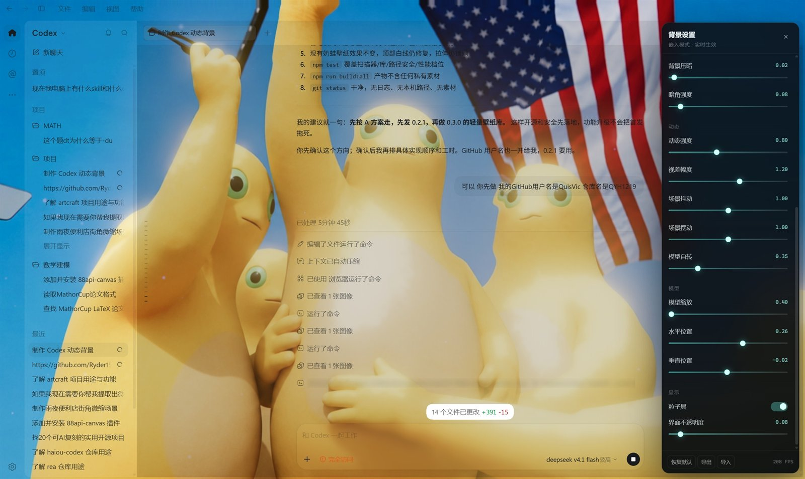
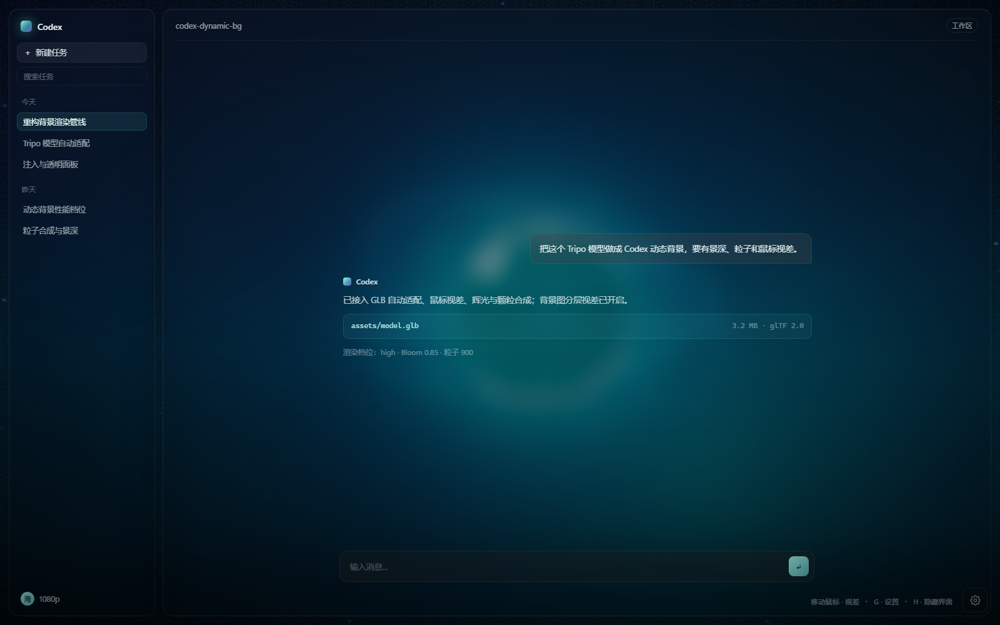

# Codex Dynamic Background

给 Codex Desktop 注入一层可交互的 WebGL 动态背景：自定义背景图、Tripo 导出的 GLB 模型、鼠标视差、辉光、粒子、模型自转，以及半透明的 Codex 面板。

**中文** | [English](README.en.md)





> 上图右侧是项目内置的本地 mock 界面（`?mock=1`），用于在没有 Codex 的环境里预览效果，不是 Codex 截图。

---

## 特性

- **整窗背景层**：背景渲染在 Codex 窗口最底层，不遮挡交互，不接管鼠标事件。
- **背景图 / 背景视频**：WebP / PNG / JPG，或 MP4 / WebM；全屏 shader 采样，带缓慢漂移与视差。
- **Tripo / glTF 模型**：GLB、glTF 直接加载，自动居中、按包围盒缩放，兼容 Draco、Meshopt、KTX2。
- **动态效果**：模型自转、鼠标倾斜、Bloom 辉光、粒子、暗角、颗粒、点击波纹。
- **可调参数**：画质、动态强度、视差、辉光、颗粒、压暗、模型缩放/位置/自转、面板透明度。
- **Codex 透明化**：主面板、左右侧栏改为半透明，设置页自动回退为不透明。
- **设置持久化**：参数写入 `localStorage`，下次注入自动恢复。
- **运行时注入**：通过 Chrome DevTools Protocol 注入，不修改 Codex 安装目录里的任何文件。
- **无素材可跑**：没有背景图和模型时自动使用程序化背景 + 水晶占位模型。
- **零后端**：所有资源本地加载，不上传、不联网、无遥测。

## 环境要求

| 项目 | 要求 |
| --- | --- |
| Node.js | >= 22 |
| Codex Desktop | Electron 版（Windows 为主，macOS/Linux 脚本为实验性） |
| 浏览器 | 支持 WebGL2 的 Chromium |
| 操作系统 | Windows 10/11（主支持）；macOS / Linux 可跑预览，注入路径需自行调整 |

## 快速开始

```bash
git clone https://github.com/<your-name>/codex-dynamic-bg.git
cd codex-dynamic-bg
npm install
npm run dev
```

打开 <http://127.0.0.1:5273/>。

首次运行会自动把 Three.js 自带的 Draco / Basis 解码器复制到 `public/vendor/`，这个目录是生成物，不提交到仓库。

### 预览模式

| URL | 效果 |
| --- | --- |
| `/` | 背景 + 本地 mock Codex 界面 |
| `/?mock=0` | 纯背景，无 UI |
| `/?mock=1` | 强制显示 mock Codex 界面 |
| `/?panel=1` | 启动时打开设置面板 |
| `/?embed=1` | 以嵌入模式挂载（无 HUD / 面板 / mock） |

快捷键：`G` 开关设置面板，`H` 隐藏/显示 HUD，`Esc` 关闭面板。

## 放入素材

把文件丢进 `public/assets/`，文件名保持下面任意一种，代码会自动探测：

```text
public/assets/background.webp   # 或 .png / .jpg / .jpeg
public/assets/background.mp4    # 或 .webm，优先于静态图
public/assets/model.glb         # 或 .gltf（兄弟目录需带 .bin 和贴图）
```

没有素材也能直接跑，会用程序化背景和占位模型。

模型适配规则：读取包围盒 → 居中到原点 → 最大边缩放到场景单位 `3.35` → 叠加边缘线框壳。模型本身的材质、贴图、动画会保留。

更细的素材规范见 [docs/ASSETS.md](docs/ASSETS.md)。

## 从 Wallpaper Engine 复刻

Wallpaper Engine 的壁纸分三类，处理方式不同：

| `project.json` 的 `type` | 复刻方式 |
| --- | --- |
| `video` | 直接导入，作为动态背景播放；可叠加视差、辉光、粒子、模型 |
| `web` | 先复制到 `public/wallpaper/`，再做一轮兼容处理（属性监听 / audio / 交互） |
| `scene` | 用 RePKG 解开 `scene.pkg`，把图层、材质、特效手工移植到 Three.js，无法一键完美还原 |
| `application` | 原生程序，不能嵌入；用它的预览视频重建 |

找到壁纸目录（Steam 库）：

```text
...\steamapps\workshop\content\431960\<壁纸ID>\
```

先看类型，不复制：

```bash
npm run wallpaper -- "D:\SteamLibrary\steamapps\workshop\content\431960\123456789" --dry-run
```

视频壁纸直接导入：

```bash
npm run wallpaper -- "D:\...\123456789"
```

会自动放到 `public/assets/background.mp4`，刷新页面即可。加 `--force` 覆盖已有文件。

Scene / Web 类型把目录整个发我，或者把 `project.json`、`preview.jpg`、`scene.json`（RePKG 解包后）丢过来，我按图层重建。

## 构建

```bash
npm run build:all
```

产物：

| 路径 | 用途 |
| --- | --- |
| `dist/` | 独立预览站点 |
| `dist-embed/codex-dynamic-bg.iife.js` | 注入 Codex 用的单文件 IIFE bundle |

单独构建：

```bash
npm run build     # 预览站点
npm run embed     # 注入 bundle
```

## 注入 Codex Desktop

注入依赖 Chromium 的远程调试端口。已经在运行的 Codex 无法中途附加调试端口，必须先退出再用启动器拉起。

### 1. 关闭 Codex，带调试端口启动

Windows：

```powershell
npm run launch:codex
```

如果 Codex 还在运行，启动器会直接报错，避免误杀你的进程。确认可以关闭时：

```powershell
powershell -NoProfile -ExecutionPolicy Bypass -File tools/launch-codex.ps1 -KillExisting
```

自定义安装路径或端口：

```powershell
powershell -NoProfile -ExecutionPolicy Bypass -File tools/launch-codex.ps1 -AppPath "C:\Path\To\ChatGPT.exe" -Port 9222
```

macOS / Linux：

```bash
bash tools/launch-codex.sh
```

### 2. 确认 CDP 可用

```bash
npm run inject -- --list
```

能看到 Codex 的 page target 就说明端口通了。

### 3. 注入

```bash
npm run embed
npm run inject
```

默认行为：

- 连接 `http://127.0.0.1:9222`
- 在 `public/assets/` 启一个本地素材服务器（默认 `5275`）
- 把 bundle 注册为 `Page.addScriptToEvaluateOnNewDocument`
- 刷新页面并校验 `#cxd-bg-root` 是否存在

注入成功后，Codex 窗口会出现动态背景。设置面板和快捷键只在预览站可用；注入模式沿用 `localStorage` 里的配置，也可以在 Console 里用 `cxdBg.setConfig()` 实时改。

### 注入器参数

```text
--port 9222          CDP 端口
--asset-port 5275    本地素材服务器端口
--assets PATH        /assets/ 映射目录（默认 public/assets）
--vendor PATH        /vendor/ 映射目录（默认 public/vendor）
--bundle PATH        注入用 IIFE bundle（默认 dist-embed/codex-dynamic-bg.iife.js）
--target TEXT        按 target id / 标题 / URL 子串选择页面
--image URL          指定背景图（URL 或 /assets/... 路径）
--model URL          指定模型（URL 或 /assets/... 路径）
--asset-base URL     覆盖素材 base URL
--no-reload          注入到当前文档，不刷新
--no-serve           不启动本地素材服务器
--list               列出 CDP page targets 后退出
-h, --help           帮助
```

示例：

```bash
npm run inject -- --image /assets/background.webp --model /assets/model.glb
npm run inject -- --no-reload
npm run inject -- --no-serve --asset-base https://cdn.example.com/bg/
```

### 撤销注入

- 重启 Codex 即可恢复原样（注入只存在于当前进程）。
- 或在 DevTools Console 执行 `window.cxdBg.dispose()`。

原理、时序和排错见 [docs/INJECTION.md](docs/INJECTION.md)。

## 配置

设置面板写入 `localStorage` 的 `codex-dynamic-bg:v1`。字段：

| 字段 | 默认值 | 说明 |
| --- | --- | --- |
| `quality` | `high` | `low` / `medium` / `high`，控制 DPR、Bloom、粒子数量 |
| `motion` | `1` | 全局动态强度 |
| `parallax` | `1` | 鼠标视差强度 |
| `bloom` | `0.85` | Bloom 强度 |
| `grain` | `0.55` | 胶片颗粒 |
| `dim` | `0.22` | 背景压暗 |
| `modelScale` | `1` | 模型整体缩放 |
| `modelSpin` | `0.35` | 模型自转速度 |
| `modelX` / `modelY` | `0.18` / `-0.02` | 模型屏幕位置偏移 |
| `particles` | `true` | 粒子开关 |
| `codexMock` | `true` | 预览站是否显示 mock 界面 |
| `surfaceOpacity` | `0.45` | Codex 面板透明度基准 |
| `showPanel` | `false` | 设置面板是否展开 |

## JavaScript API

注入完成后页面里会有 `window.cxdBg`：

```js
// 运行时改参数（会写入 localStorage）
cxdBg.setConfig({ bloom: 1.2, modelSpin: 0.6, quality: 'medium' });

// 恢复默认值
cxdBg.reset();

// 当前素材探测结果
console.log(cxdBg.assets);
// { imageUrl, modelUrl, background: 'image'|'placeholder', model: 'glb'|'placeholder' }

// 卸载背景层
cxdBg.dispose();
```

挂载完成时还会派发：

```js
window.addEventListener('cxdbg-ready', (event) => {
  console.log(event.detail);
});
```

## 项目结构

```text
.
├─ index.html
├─ src/
│  ├─ main.js            # 预览站入口
│  ├─ embed.js           # 注入入口 + Codex CSS 适配
│  ├─ mount.js           # 生命周期、素材探测、API
│  ├─ scene.js           # Three.js 场景与渲染循环
│  ├─ post.js            # Bloom / 颗粒 / 暗角
│  ├─ shaders.js         # 背景 / 模型 / 粒子 shader
│  ├─ assets.js          # 素材探测与程序化占位
│  ├─ ui.js              # HUD / 设置面板 / mock 界面
│  ├─ config.js          # 默认值 + localStorage
│  ├─ style.css
│  └─ scene/
│     ├─ background.js
│     ├─ model.js        # GLB 加载、自动适配、自转
│     └─ particles.js
├─ tools/
│  ├─ inject.mjs         # CDP 注入器 + 本地素材服务器
│  ├─ sync-decoders.mjs  # 复制 Draco / Basis 解码器
│  ├─ wallpaper.mjs      # Wallpaper Engine 壁纸导入 / 类型识别
│  ├─ launch-codex.ps1
│  └─ launch-codex.sh
├─ public/assets/        # 你的背景图与模型（默认不提交）
├─ docs/
└─ .github/workflows/
```

架构说明见 [docs/ARCHITECTURE.md](docs/ARCHITECTURE.md)。

## Tripo 模型说明

Tripo 导出的 GLB 通常可以直读。建议导出时：

- 选 **GLB**（单文件，含贴图），不要只给 OBJ。
- 贴图控制在 2K 以内，单模型建议 < 15 MB。
- 需要压缩时优先用 Draco 或 Meshopt；本项目已内置对应解码器。
- 有 PBR 贴图时确认 `baseColor` / `metallicRoughness` / `normal` 都打进 GLB。

模型加载失败不会中断页面，会回退到占位水晶，并在控制台给出原因。

## 兼容性与已知限制

- Codex 升级后 DOM class 可能变化，透明面板样式集中在 `src/embed.js` 的 `CXD_CODEX_CSS`，改这一处即可。
- 注入只对当前 Codex 进程有效，重启后需要重新执行 `npm run inject`。
- CDP 端口只应绑定在 `127.0.0.1`，不要暴露到局域网。
- 高画质 + 4K 背景 + 大模型会明显吃 GPU；卡顿时先降 `quality`，再关粒子。
- Linux / macOS 的 Codex 安装路径与进程名不同，`launch-codex.sh` 需要按实际环境改。

## 隐私

- 不收集任何数据，无网络请求（除本地素材服务器与页面自身）。
- 素材只从本地目录读取，不会上传。
- 注入脚本通过 CDP 下发，不写入 Codex 安装目录。

## 贡献

见 [CONTRIBUTING.md](CONTRIBUTING.md)。安全问题见 [SECURITY.md](SECURITY.md)。

## License

[MIT](LICENSE)

非官方项目，与 OpenAI 无隶属关系。Codex 名称与商标归其所有者。

